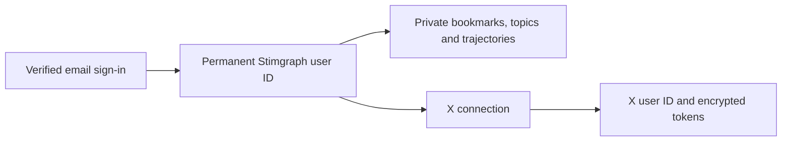

# Email login and X connections

The recommended first launch is a small invite-only service. Use managed email sign-in to identify a Stimgraph user, and connect X separately as a source of bookmarks. The domain can be chosen after development; production sign-in and OAuth callbacks must use the final hostname.

## Ownership

Email addresses and X handles can change. Neither should be the workspace's primary key. The login email does not need to match an email associated with X. Connecting X grants access to its data; it should not switch which Stimgraph account is signed in.

For a standalone app, use a managed authentication service for email verification, sign-in sessions, account recovery, and optional passkeys. Clerk's managed email-code sign-in is one option. Keep X out of automatic social-login account linking: Stimgraph needs an explicit data connection under an already signed-in user. [Clerk sign-in options](https://clerk.com/docs/guides/configure/auth-strategies/sign-up-sign-in-options), [Clerk account-linking behavior](https://clerk.com/docs/guides/configure/auth-strategies/social-connections/account-linking).

The current Sites workspace identity can protect a private prototype inside that environment. That is a different launch model from offering standalone email sign-in to the public. Select the hosting/authentication setup before implementing the identity migration; do not assume a workspace header exists on a standalone deployment.

## Proposed records

| Record | Owner and contents |
| --- | --- |
| `app_users` | Internal UUID, unique verified authentication-provider subject, invite status, creation time. Keep email with the auth provider unless the app needs a verified copy for display or support. |
| `x_connections` | Internal connection ID, `app_user_id`, unique X user ID, display handle, encrypted access/refresh tokens, expiry, scopes, and connection status. Initially allow one X account per app user and one app user per X account. |
| Bookmarks and source topics | `app_user_id` plus `x_connection_id`, so each imported collection has explicit ownership and provenance. |
| Trajectories and notes | `app_user_id`; they remain part of the workspace when X is disconnected. |
| Usage limits | `app_user_id`, action, and timestamps/counts. Keep content and credentials out of usage logs. |
| Pending X connection | Random one-use state, PKCE verifier, expiry, intended app user, and initiating app session. |

Every private API derives `app_user_id` from a verified app session on the server. Queries and mutations include that owner. A user ID, email, or X account supplied by the browser is not authorization. Verify provider tokens with its supported server integration; do not trust arbitrary email headers.

## User flow

1. An invited person verifies their email and signs in. The app creates or loads their permanent user ID from the auth provider's subject.
2. They press Connect X while signed in. Store the intended app user and session with the short-lived OAuth state and PKCE verifier.
3. On return, check state, the initiating browser, and the authenticated app user before exchanging the code and saving the X connection.
4. If that X account is already attached to another app user, stop and explain the conflict. Do not merge workspaces by matching emails or silently move the connection. Any recovery or transfer needs a separate, verified flow.
5. Load only this user's collection. Changing login email retains the same app user ID. Signing out clears the app session; disconnecting X removes its credentials and stops imports; deleting the workspace removes its stored data. Present these as separate actions.

Cloudflare Access can add an email allowlist in front of the app for a pilot. Protect every app/API hostname and any alternate origin. This entry gate does not replace account ownership checks inside the app. [Cloudflare Access policies](https://developers.cloudflare.com/cloudflare-one/access-controls/policies/).

## Current code and migration

The prototype currently derives `owner_id` from the X profile ID and uses its X session as the application session. That separates current X collections, but is not the proposed email-account architecture. New concept-bridge queries also use this existing server-verified owner and reload their evidence from that owner's database records.

The current OAuth flow now requires the callback state to match a short-lived httpOnly cookie in the browser that started the connection. Once independent app login exists, the callback must additionally enforce the pending record's intended app user and session.

Implement the migration after the hosting/auth choice:

1. Add managed email sign-in and the new records. Keep existing maps until each owner has verified both their app login and their X connection.
2. In a transaction, associate that legacy X owner with the new app user and backfill ownership. Never claim an existing collection from a typed handle or email address.
3. Move every private route to an app-session helper. X token refresh is used only for operations that need X. An expired or disconnected X token should not lock someone out of their own notes.
4. Verify two-user isolation across imports, search, bridges, trajectories, deletion, background jobs, and exports. Check linking conflicts, session expiry, email changes, and disconnect/reconnect behavior.
5. Disable or gate existing public share routes, configure production callbacks, set usage budgets, and test recovery and deletion before inviting others.

No email provider, public launch, domain purchase, or ownership migration has been configured by the concept-bridge change. This document describes the next implementation, not a completed launch.
