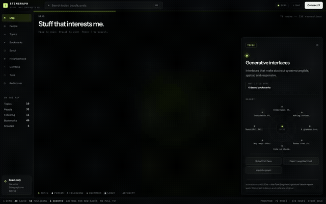

# Stimgraph

> **Status: early / under active development; expect breaking changes.** Schemas, routes, and the UI can change between commits. Pin a commit if you depend on it.

**STIM = Stuff That Interests Me.** Stimgraph pulls your X bookmarks into a private database on your own machine and turns them into something you can explore: a searchable table with topic chips, a 3D globe of the topics, people, and posts you save, research tools, and a read-only link your AI agents can query ("what have I saved about…?"). It is read-only against X, it runs on `127.0.0.1`, and your data never leaves your machine unless you press an optional Grok action.



Full silent walkthrough: [public/demo/stimgraph-silent.mp4](public/demo/stimgraph-silent.mp4). The data in the demo is the built-in fake DEMO collection.

> **Disclaimer.** Not affiliated with, endorsed by, or sponsored by X Corp. X is a trademark of X Corp. Users must supply their own X API credentials and comply with the [X Developer Agreement and Policy](https://developer.x.com/en/developer-terms/agreement-and-policy).

More docs: [docs/FEATURES.md](docs/FEATURES.md) (feature behavior), [docs/DEPLOYMENT.md](docs/DEPLOYMENT.md) (always-on Mac service), [docs/PRODUCT.md](docs/PRODUCT.md), [AGENTS.md](AGENTS.md) (rules for coding agents).

## Prerequisites

| Tool | Version | How to get it |
| --- | --- | --- |
| Node.js | **22.13+** for development (`.nvmrc` pins 22); **24.15+** for always-on mode | `nvm install && nvm use` |
| pnpm | **10.x** (pinned via `packageManager` in `package.json`) | `corepack enable` |
| git | any recent | your OS package manager |
| X developer app | needed only to import *your* bookmarks | see [Connecting X](#connecting-x) |
| xAI API key | optional (Grok features) | [console.x.ai](https://console.x.ai) |

macOS, Linux, and Windows (WSL) work for development. Always-on mode is macOS-only.

## Quickstart

Copy-paste this. No credentials are needed to see the app: it starts with a built-in, clearly labeled **DEMO** collection.

```bash
git clone https://github.com/sandbornm/stimgraph.git
cd stimgraph
nvm use                          # optional if you already run Node 22.13+
corepack enable                  # provides the pinned pnpm
pnpm run setup                   # checks prereqs, creates .env.local from .env.example
pnpm install --frozen-lockfile
pnpm dev                         # http://127.0.0.1:3001
```

`pnpm run setup` (equivalently `node scripts/setup.mjs`) never overwrites an existing `.env.local` and never prints its contents. Dependency install scripts are disabled by `.npmrc`; that is intentional.

To import your own bookmarks, fill in `X_CLIENT_ID` and `X_CLIENT_SECRET` in `.env.local`, restart `pnpm dev`, open the app, and press **Connect X**.

## Two ways to run it

| | Development mode | Always-on mode |
| --- | --- | --- |
| What it is | `pnpm dev` (Vite + Cloudflare Workers runtime via Miniflare) on `http://127.0.0.1:3001` | Production Next.js server on `127.0.0.1:3001`, published privately with Tailscale Serve, supervised by launchd |
| OS | macOS, Linux, Windows (anything Node and workerd support) | **macOS only** |
| Node | 22.13+ (`.nvmrc` pins 22) | **24.15+** (uses `node:sqlite`; tested on 24.17) |
| Storage | Local D1/SQLite under `.wrangler/` | `.tailnet/state/stimgraph.sqlite` |
| Credentials | `.env.local` | Keychain items (preferred) — see DEPLOYMENT.md |
| Bookmark import | When you press Sync, plus a visible tab checks the newest 15 every 90 s | Background poll every 6 h, plus a one-time backfill |
| Agent link | Requires your browser session | `https://<host>.<tailnet>.ts.net/agents` from your tailnet |

## Connecting X

1. **Create your own X developer app** in the [X Developer Console](https://console.x.com/). X API access is paid and its plans/pricing change; check the console before relying on it. Every bookmark sync, follow import, and background poll consumes X reads billed to *your* app.
   - Type: confidential **Web App, Automated App or Bot**. Permissions: **Read**.
   - OAuth 2.0 scopes requested by Stimgraph (exactly): `tweet.read users.read bookmark.read follows.read offline.access`. No write scopes.
   - Callback URL (must match `X_REDIRECT_URI` exactly):
     - Development: `http://127.0.0.1:3001/api/auth/x/callback`
     - Always-on: `https://<host>.<tailnet>.ts.net/api/auth/x/callback`
   - Website URL: any public page you own (it is only a label).
2. **Optional: an xAI API key** for Grok topic enrichment, scouting, bridges, and research drafts. Everything else works without it.

## Environment variables

All variables are listed, with comments, in [.env.example](.env.example). For development, `pnpm run setup` copies it to `.env.local` (gitignored); edit values there and never commit or paste that file.

| Variable | Required | Default | Purpose |
| --- | --- | --- | --- |
| `X_CLIENT_ID` | yes | — | OAuth 2.0 client ID of your X app |
| `X_CLIENT_SECRET` | yes | — | OAuth 2.0 client secret; also encrypts stored X tokens (changing it forces reconnect) |
| `X_REDIRECT_URI` | yes | — | Exact callback URL registered in the X app |
| `XAI_API_KEY` | no | empty (Grok features off) | xAI key for optional Grok features |
| `TYPESAFE_API_KEY` | no | empty (Jev labeling off) | TypeSafe AI key for optional Jev topic labeling |
| `NEXT_PUBLIC_SITE_URL` | no | `http://127.0.0.1:3001` | Public URL for social metadata |
| `STIMGRAPH_TAILNET` | always-on | `false` | Enables Tailscale identity checks and HTTPS origin handling |
| `STIMGRAPH_TAILNET_LOGIN` | always-on | — | The one Tailscale login allowed to use the app remotely |
| `STIMGRAPH_PUBLIC_ORIGIN` | always-on | — | `https://<host>.<tailnet>.ts.net` |
| `STIMGRAPH_DATABASE` | always-on | — | Absolute path of the SQLite database |
| `STIMGRAPH_BACKGROUND_POLL` | no | `false` | `true` polls connected accounts every 6 h |
| `STIMGRAPH_CREDENTIAL_SOURCE` | no | `none` | `keychain` loads X/xAI credentials from macOS Keychain at startup |
| `STIMGRAPH_AGENT_API` | no | on | `off` disables tailnet (cookie-less) agent access |
| `STIMGRAPH_AGENT_LOGINS` | no | empty | Optional allowlist of Tailscale logins for the agent API. Empty means any login that passes the tailnet gate, which in always-on mode is only `STIMGRAPH_TAILNET_LOGIN` |

The always-on variables are written into the LaunchAgent by `scripts/install-tailnet-service.mjs` from `.tailnet/service.json`; you do not set them by hand. Secrets never go in the plist.

## Optional: Jev topic labeling (TypeSafe AI)

If `TYPESAFE_API_KEY` is set (env in development; Keychain item `net.stimgraph.TYPESAFE_API_KEY`, account `stimgraph`, in always-on mode), Stimgraph sends [Jev](https://docs.typesafe.ai) one request per bookmark with three *Choice* questions: which topic from your list fits best, **why you saved it** (`try`, `read`, `reference`, `inspiration`), and whether it is still **actionable or stale** (time-bound news that has likely gone out of date).

- **Topic list:** editable per owner via `GET`/`PUT /api/jev` (`{ "topics": { "label": "description", ... } }`, up to 255). The default is agents, openai, claude, models, code, security, crypto-payments, design, startups, other.
- **Once per post:** the label, intent, stale flag, confidences and model version are cached in `jev_labels` (migration `0007` adds the nullable intent/stale columns; posts labeled before it get intent/stale once on the next run). A post is relabeled only if its text or the topic list changes.
- **When:** new bookmarks are labeled after each sync (up to 200 per run). Label existing ones once with `STIMGRAPH_URL=https://<host>.<tailnet>.ts.net pnpm jev:label` (or `http://127.0.0.1:3001` in development, signed in).
- **Fallback:** answers below 0.5 confidence or "other" add no Jev topic, so keyword chips apply. Intent or stale answers below 0.5 are stored as `null` (unknown).
- **UI:** one screen: search box, a row of why-saved chips and topic chips (click to filter), and the table. Posts flagged stale are hidden by default; the "Show stale" toggle brings them back. Explore, Globe, People, Topics and the other views live behind **More** in the left rail. Jev topics appear as chips marked ◆ (ids start with `jev-`); keyword chips are dashed.
- **Data sent:** the post text (first 4,000 characters), the author handle, and your topic list. No X credentials. Requests run 4 at a time and retry `429`/`5xx` with backoff.
- **Cost:** Jev bills input tokens only. At the published price when this was written (about $0.042 per million input tokens) a typical request is ~600 tokens, so labeling 800 bookmarks costs on the order of $0.02. Check TypeSafe's current [models and pricing](https://docs.typesafe.ai/models) page.

## Limits and expectations

- **X returns only your newest ~800 bookmarks.** Older saves cannot be imported through the API. If you have fewer, you get all of them (e.g. one account had 199).
- Always-on polling runs every **6 hours** (reads 20 per page, up to 5 pages, stops at the first already-stored post). The first poll after setup does a one-time **backfill** of up to 800 without stopping early.
- Polling cannot detect un-bookmarking, and post creation time is not bookmark time.
- Topic chips come from hashtags and Grok topics; posts without either get simple keyword chips (`kw-…`). There are no embeddings yet.
- Single owner: the app assumes one connected X account per database.

## Where data lives

- Bookmarks, topics, OAuth sessions (tokens encrypted with `X_CLIENT_SECRET`), trajectories, and research cards: the local database (see table above). Protect it and its backups; enable FileVault on the always-on Mac.
- The browser holds only an httpOnly session cookie (`stim_x_session`, 180 days) and UI preferences.
- Nothing is sent to xAI or Crossref unless you press the corresponding action; see the permission boundary below.

## Security model

- The server binds to **127.0.0.1** only, never a LAN interface.
- Always-on mode is reached through **Tailscale Serve** (private HTTPS; Funnel is not enabled). Serve sets and sanitizes the `Tailscale-User-Login` header, and the app trusts that header **only** because the listener is loopback-only; any local process on the Mac can impersonate it. Requests must carry the configured login; tagged devices are denied.
- The agent API is **read-only** and never returns tokens. It answers to the browser session, or (always-on mode only) to the configured Tailscale login on a `*.ts.net` host. Disable it with `STIMGRAPH_AGENT_API=off`.
- Keychain under the same macOS login is **not** isolation from local coding agents; see DEPLOYMENT.md for a stronger setup.
- Dependency install scripts are disabled (`--ignore-scripts`). Secret files are never read by tooling; see AGENTS.md.

## Permission boundary

Stimgraph requests these OAuth scopes:

- `bookmark.read` to read bookmarks when Sync is pressed.
- `follows.read` to read accounts you follow when Sync is pressed.
- `tweet.read` to read the saved post text.
- `users.read` to identify authors.
- `offline.access` to refresh the connection when the user requests a later sync.

It does not request write scopes and cannot post, like, follow, or change bookmarks. Development import starts on request; the opt-in private deployment in [DEPLOYMENT.md](docs/DEPLOYMENT.md) polls connected accounts in the background. If you connected before following import existed, reconnect so X can grant `follows.read`. In the [X Developer Console](https://console.x.com/), add `follows.read` to the app’s user-authentication scopes.

Grok enrichment is a separate action. Pressing it sends the next 40 bookmark texts and author handles to xAI; it never sends the X access token. Grok scout sends only topic labels and frequent author handles, then searches X. Requests use `store: false`. xAI documents a default 30-day abuse-monitoring retention period unless the API team has Zero Data Retention enabled, and says API inputs and outputs are not used for training without explicit permission. See [xAI API security](https://docs.x.ai/developers/faq/security) and [current pricing](https://docs.x.ai/developers/pricing).

The app exposes separate controls to disconnect the browser session or delete the locally stored graph. Withdrawing the X app’s account-level authorization is done in X account settings.

## Agent access (read-only)

Give an agent `https://<host>.<tailnet>.ts.net/agents` (or `/llms.txt`). JSON endpoints: `/api/agent/bookmarks?q=&topic=&author=&intent=&stale=&limit=` (each bookmark carries `intent` and `stale`; `intent=try&stale=hide` gives a short to-try list), `/api/agent/topics`, `/api/agent/export?format=md|json` (same filters). No MCP server or install is needed; any agent that can fetch a URL on your tailnet can use it.

### How this fits with agents that already read X

Assistants such as Grok Bot can already reach X in two ways (as of October 2026; check the assistant's own docs for current details):

- **Built-in public reads** of posts, users, and search. These do not act as you, so they cannot see your bookmarks.
- **An optional X plugin** that signs in as you and can read things like bookmarks, DMs, and your timeline, but cannot post.

Stimgraph does not replace either. It is a **local, persistent store** of your bookmarks with topics and a read-only agent link:

- Queries against Stimgraph are free and instant; they do not spend X API calls each time an agent asks a question.
- It keeps history between sessions and adds structure (topics, people, trajectories) that a live X read does not.
- Stimgraph itself imports through **your own X developer app** (your credentials, your API costs), on your schedule, and never posts.

A reasonable pattern: use the assistant's X access for live or public lookups, and point it at Stimgraph for "what have I saved about…" questions.

## Run, test, and deploy

```bash
pnpm dev              # development server, http://127.0.0.1:3001
pnpm run check        # typecheck + lint + unit tests
pnpm run build:local  # Next.js production build (no credentials needed)
pnpm run start:local  # serve that build on 127.0.0.1:3001
```

CI (`.github/workflows/ci.yml`) runs `check` + build on Node 22, the local SQLite integration test on Node 24, and a gitleaks history scan. Builds and tests use inert credentials passed directly to the process, never `.env.local`. Integration tests (`scripts/test-local.mjs`, `scripts/test-background.mjs`) are described in [docs/DEPLOYMENT.md](docs/DEPLOYMENT.md).

**Deploy:** there is no hosted version. The supported deployment is the private always-on Mac service (Tailscale Serve + launchd) in [docs/DEPLOYMENT.md](docs/DEPLOYMENT.md). Do not expose the server on a public interface; its auth model assumes loopback + Tailscale.

## Troubleshooting

| Symptom | Fix |
| --- | --- |
| `pnpm: command not found` | `corepack enable`, then open a new shell. |
| `Unsupported engine` / syntax errors on start | Node is too old. `nvm use` (needs 22.13+; 24.15+ for always-on). |
| `Port 3001 is already in use` | Something else (often the always-on service) is listening. Stop it (`lsof -i :3001`), or for a quick DEMO-only look use `pnpm dev --port 3013`. Connecting X needs port 3001, because the callback URL must match exactly. |
| X login fails with a callback / redirect error | `X_REDIRECT_URI` in `.env.local` must match the callback URL in your X app **character for character** (use `127.0.0.1`, not `localhost`). |
| App still shows DEMO after connecting | Sync runs on request: press **Sync**. X only returns your newest ~800 bookmarks. |
| Every request after a change says "reconnect" | You changed `X_CLIENT_SECRET`; stored tokens are encrypted with it. Press Connect X again. |
| Grok actions fail or say they are not configured | `XAI_API_KEY` is empty. That is fine; everything else works. |
| `pnpm install` warns that build scripts were ignored | Expected: `.npmrc` sets `ignore-scripts=true`. |
| `pnpm run typecheck` errors in `.next/types` after a build | Stale generated types: `rm -rf .next` and re-run. |
| Weird state after pulling new commits | Stop the server, `rm -rf .wrangler`, `pnpm install --frozen-lockfile`, `pnpm dev`. This resets local dev data. |

## License

[MIT](LICENSE). Copyright (c) 2026 Michael Sandborn.
