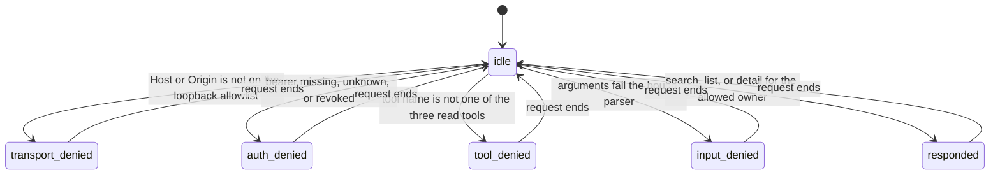
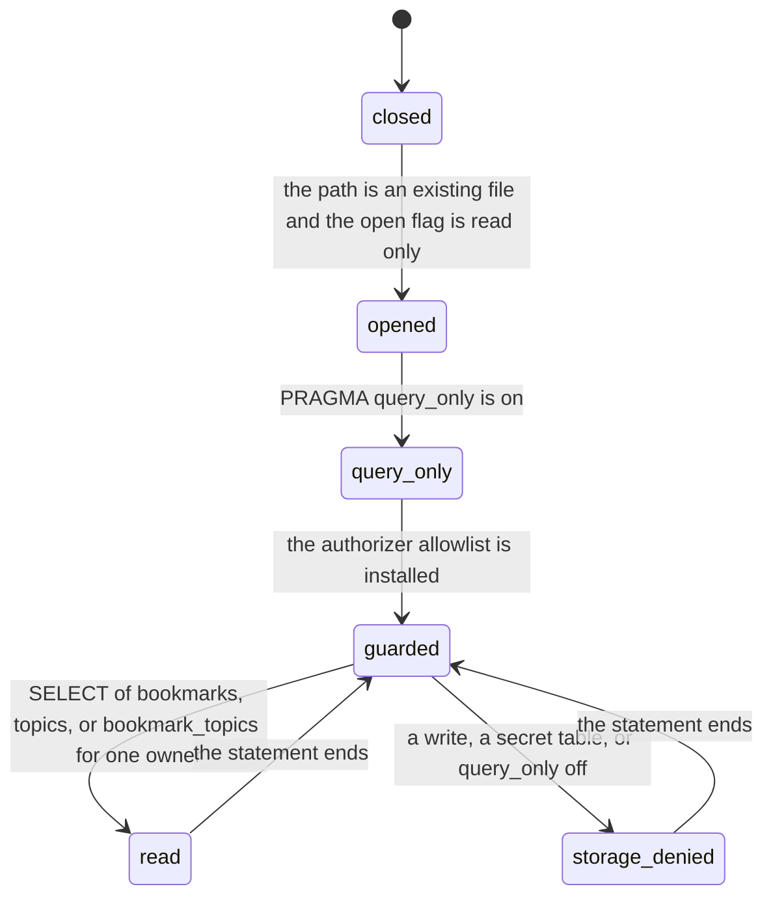

# Stimgraph bookmark MCP security spec

Spec version 1.0.0. Dated 2026-11-10. Crate `stimgraph-mcp` 0.1.0.

This is the reference for the loopback server in `mcp/`. Why the labels conflict is in the [security model](mcp-security-model.md). A passing model check is not a proof of the Rust, the SDK, the operating system, or Tailscale.

This spec describes the private server in this repository. It does not describe a public product page, a registry entry, or a control tool. Those are outside this version.

## Subjects

| Subject | What it is in this server |
| --- | --- |
| Anonymous caller | An HTTP client with no accepted bearer token. |
| Active principal | A row in `STIMGRAPH_MCP_PRINCIPALS` whose `revoked` field is false. |
| Revoked principal | The same row with `revoked` true. The process reads the bit at start. |
| Bookmark MCP process | The `stimgraph-mcp` process. After `authorize` allows one owner, the process may read that compartment. |
| Operator | The person who starts the process and supplies the principal map. The map is not a client argument. |

The process does not keep an application session past the one stateless HTTP request the SDK handles. Revocation is not a live control message.

## Objects

| Object | Where it lives |
| --- | --- |
| Bookmark row | `bookmarks` for one `owner_id`. |
| Topic row | `topics` and `bookmark_topics` for one `owner_id`. |
| Secret credential row | `x_sessions`, `oauth_pending`, and account token payloads. The server has no query for these tables. |
| Principal map | Process environment, then SHA-256 digests in memory. |
| Tool arguments | JSON on `tools/call`. |
| Response bytes | The HTTP response for that request. |

## Labels

Confidentiality, from lower to higher. `public` and `owner` are comparable. `secret` is above `owner`. No MCP principal is cleared for `secret`.

| Label | Objects |
| --- | --- |
| public | Fixed denial text, bound-error text, and the not-found result. |
| owner | Bookmark and topic fields for one owner. |
| secret | Session payloads, OAuth verifiers, tokens, and the database path. |

The owner label has a compartment. The compartment is the owner id string. A principal cleared for `owner` and compartment `owner-a` is not cleared for compartment `owner-b`.

Integrity, from lower to higher.

| Label | Objects |
| --- | --- |
| low | Bookmark text, topic labels, and client argument strings. |
| medium | The binding from an accepted token digest to one principal. The operator endorsed the map. The caller that presents the token did not. |
| high | `authorize`, the SQL strings, the SQLite authorizer, and `query_only`. |

## Rules the server enforces

Bell-LaPadula. No read up. An active principal may read `public` objects and `owner` objects in its own compartment. It may not read `secret` objects or another compartment. No write down. The server has no write tool, and the database connection rejects writes, so there is no path that writes owner data into a public object.

Strict Biba. No read down. No write up. Low-integrity arguments cannot update the principal map, the SQL strings, or the database. The high-integrity service does read low-integrity bookmark text. That read is the trusted mediator in the security model. It is not a claim that strict Biba holds for the whole process.

## Access matrix

A cell is the access this server grants. Read means the field can appear in a successful tool result. Deny means the response carries no field from that object.

| Subject | Own bookmarks and topics | Another owner's rows | Secret credential rows | Principal map | Public denial text |
| --- | --- | --- | --- | --- | --- |
| Active principal | Read | Deny | Deny | Deny | Read |
| Revoked principal | Deny | Deny | Deny | Deny | Read |
| Anonymous caller | Deny | Deny | Deny | Deny | Read |
| MCP process before `authorize` | Deny | Deny | Deny | Read the digests it loaded | Write the fixed denial |
| MCP process after `Allow` | Read that compartment through the mediator | Deny | Deny | Read the digests it loaded | Write fixed errors |

Two active principals may name the same owner id. That is two subjects in one compartment. It is not a clearance for every owner. The server does not invent a clearance the map does not state.

## Request states

The states below are the states of one request. The model checker uses the same names. `Reset` in the model is only the return to `idle` before the next independent request.

| State | Guard in the code | What the caller can observe |
| --- | --- | --- |
| idle | No request in this model step. | Nothing. |
| transport_denied | `streamable_config` allows hosts `127.0.0.1`, `localhost`, and `::1`, and origins `http://127.0.0.1:*`, `http://localhost:*`, and `http://[::1]:*`. The pinned SDK rejects other `Host` and `Origin` values. A missing `Origin` is accepted. | HTTP 403. The body contains `Host` or `Origin`. No bookmark field. |
| auth_denied | `authenticate_request` requires `Authorization: Bearer`. `authenticate` compares SHA-256 digests and drops revoked principals. Unknown and revoked tokens produce the same body. | HTTP 401. The body is `unauthorized\n`. |
| tool_denied | The tool router registers only `search_bookmarks`, `list_bookmarks`, and `get_bookmark`. | A protocol error from the SDK. No stored bookmark text. |
| input_denied | `parse_search`, `parse_list`, and `parse_post_id` reject the argument before SQL. | A protocol error whose message is one of the fixed bound messages. |
| responded | `authorize` returned `Allow` with one owner id. `ReadOnlyStore::search` or `ReadOnlyStore::get` ran. | A tool result. Success content is the owner compartment at low integrity. Not-found content is public at high integrity. The not-found object is the same for an unknown id and for another owner's id. |

`authorize` returns `Deny` with no owner id when the principal is missing or revoked, for every read tool. There is no write variant of `Tool`.

## Storage states

`ReadOnlyStore::open` opens with `SQLITE_OPEN_READ_ONLY`, sets `query_only`, then installs the authorizer. The authorizer allows `SELECT` and reads of `bookmarks`, `topics`, and `bookmark_topics`. It denies other tables, including `x_sessions`. It denies inserts, updates, deletes, schema changes, and a `query_only` pragma that would turn the flag off.

Statements are fixed strings with `?` parameters. The owner id is bound from `authorize`. For detail, the post id is bound from `parse_post_id`. Search terms, the author, and the topic are applied in `row_matches` after the owner-scoped read.

`open` on a missing path returns an error and does not create a file. Startup runs no migration.

The owner read is capped at 5000 rows. Above that, the tool returns `owner_window_exceeded` and no row text.

## Response channels

| Result | Confidentiality | Integrity | Stored bookmark text |
| --- | --- | --- | --- |
| HTTP 401 and HTTP 403 | public | high | Absent |
| Bound error and unknown tool | public | high | Absent |
| `bookmark_not_found` | public | high | Absent |
| `owner_window_exceeded` | owner, caller's compartment | high | Absent |
| Search, list, or detail success | owner, caller's compartment | low | Present, as data |

Success JSON includes `channel.confidentiality`, `channel.integrity`, and `channel.compartment`. The compartment is the owner id from the principal, not from the tool arguments.

## Secrets

The principal JSON is read from `STIMGRAPH_MCP_PRINCIPALS`. Each token is hashed with SHA-256, compared with a constant-time compare over the digest, and wiped in the parsed string. `from_env` then removes that variable from the process environment. The operating system may still have held the original environment block. The server does not read `.env` files. It does not log the authorization header, tool arguments, or bookmark text. The 401 body sends `cache-control: no-store`. The database path is not a tool result.

## Model check

TLC 2.19 from `tla2tools.jar` 1.7.4 checks `mcp/tla/BookmarkMcp.tla` with `Leak = FALSE`. The run on 2026-11-10 found no invariant error. It generated 36 states, of which 15 were distinct. The depth of the state graph is 2. The fingerprint collision estimate TLC printed was `1.7E-17`.

The invariants are `NoMutation`, `DeniedQuiet`, `Separation`, `RevokedQuiet`, and `AnonQuiet`.

`BookmarkMcpLeak.cfg` sets `Leak = TRUE`. TLC reports that `Separation` is violated. The shortest behavior is idle, then `Search` by `agent_a`, with `disclosed` containing post `201` of `owner_b`. `stored` is unchanged in that behavior. That config is a broken model, not a mode of the server.

## Map from the model to the code and tests

| Model action | Code | Test |
| --- | --- | --- |
| `BadTransport` | `streamable_config` | `auth_origin_and_host_rejections_are_empty_of_bookmark_text` |
| `RejectAnon` | `authenticate_request` | The same test, missing bearer. |
| `RejectRevoked` | `authenticate` | The same test. The revoked body equals the unknown body. |
| `RejectUnknownTool` | Tool router | `invalid_calls_disclose_no_stored_text_and_do_not_write` calls `execute_sql`. |
| `RejectBadInput` | `parse_search`, `parse_list`, `parse_post_id` | The same test, for limit, cursor, and post id. |
| `Search` and `List` | `search_bookmarks`, `list_bookmarks`, `ReadOnlyStore::search` | `official_client_searches_lists_and_reads_only_its_owner` |
| `Detail` | `get_bookmark`, `ReadOnlyStore::get` | The same test. Post `201` and post `999` return the same not-found result. |
| `NoMutation` | Read-only open, `query_only`, authorizer | Corpus and database file bytes in the protocol tests, and `connection_rejects_writes_and_secret_tables`. |

Removing the owner predicate from `BOOKMARKS_BY_OWNER` makes the official-client test fail. On the scratch copy, a page for `owner-a` included post `201` and the text `OTHER_OWNER_BOOKMARK_TEXT`. That edit was not kept.

## Bounds the model does not cover

The model does not parse HTTP, JSON, or SQL. It does not model term matching, pagination, or the 5000-row window. It does not model the SDK session code, SQLite, the operating system, or Tailscale. Host and origin rejection is the configured outcome of the pinned SDK check, not a proof of that check. Tailscale is not an identity source for this process.

## Unresolved policy

Bookmark rows for one owner share one confidentiality label. The schema has no per-bookmark label, and this spec does not invent one. Demo rows are not a separate label. If a principal is bound to a demo owner id, that principal can read those rows.

The web agent API accepts several topic ids. This server accepts one topic string.

A revoked token keeps working until the operator restarts the process with `revoked` true or removes the row. There is no push revocation.

Gateway metering and API-key brokering are out of scope. This server has no payment and no public API.
